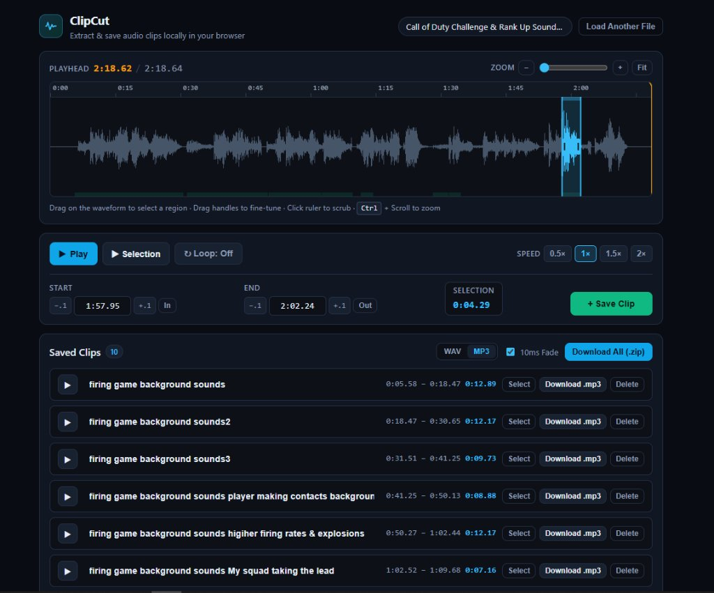
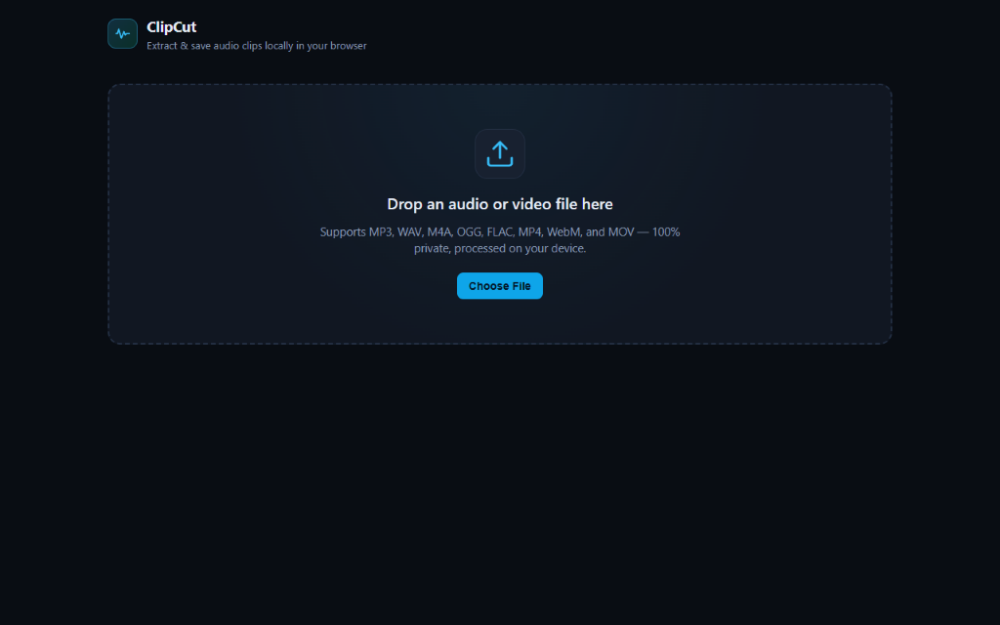
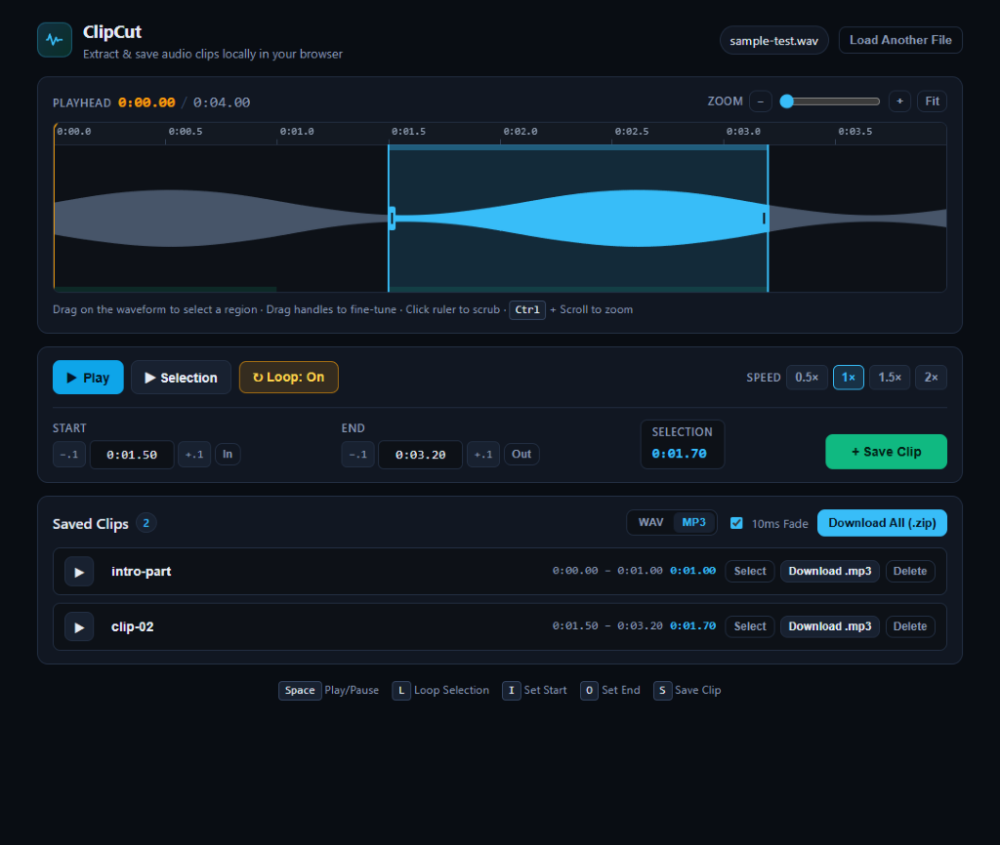

# ClipCut

**A fast, simple, distraction-free web app for cutting and saving multiple audio clips from long audio or video files — 100% in your browser.**



---

## Why I Built This

> I just wanted to edit a soundtrack online and pull out a few small audio clips — without paying for a subscription, downloading heavy apps, or dealing with watermarks and ads. I couldn't find a simple tool that just did that cleanly, so I built my own.

No accounts. No uploads to a remote server. No paywalls. Just drop your file, highlight the parts you want, and download them.

---

## Features

- **Audio & Video Support:** Load `MP3`, `WAV`, `M4A`, `OGG`, `FLAC`, or video files (`MP4`, `WebM`, `MOV`) and automatically extract the audio track.
- **100% Client-Side & Private:** All decoding, playback, slicing, and encoding happen locally in your browser using the Web Audio API. Your files never leave your device.
- **Interactive Zoomable Waveform:** Click and drag to select a region, drag the start/end handles to fine-tune, click the time ruler to scrub, or hold `Ctrl` + scroll to zoom in closely.
- **Seamless A–B Looping & Speed Control:** Toggle **Loop** to repeat your exact selection by ear while dialing in cut points, and switch playback speed (`0.5×`, `1×`, `1.5×`, `2×`) to skim long recordings fast.
- **Multi-Clip Queue:** Keep your full file loaded while you save as many clips as you need. Rename clips inline, preview any clip, re-select its region on the waveform, or delete it.
- **Clean WAV & MP3 Export + Batch ZIP:** Export lossless **WAV** or **MP3**, toggle a `10ms` fade-in/out to avoid clicks/pops at cut boundaries, and download clips individually or all at once as a `.zip`.

---

## How It Works

1. **Drop or Choose a File:** Open ClipCut and drop any supported audio or video file onto the page.
2. **Select Your Region:** Drag across the waveform (or use the `Start` / `End` fields, `±0.1s` nudge buttons, or `I` / `O` shortcuts) to frame the exact sound you want.
3. **Preview & Loop:** Hit **Selection** or toggle **Loop** (`L`) to listen back and tweak the handles until the cut is clean.
4. **Save & Download:** Click **+ Save Clip** (`S`) to add it to your list, repeat for every clip you need, then download individual files or hit **Download All (.zip)**.

---

## Screenshots

### Dropzone (Start Screen)


### Selection, Looping & Saved Clips


---

## Keyboard Shortcuts

| Key | Action |
| --- | --- |
| `Space` | Play / Pause |
| `L` | Toggle Loop on current selection |
| `I` | Set selection **Start (In)** at current playhead |
| `O` | Set selection **End (Out)** at current playhead |
| `S` | Save current selection to the clip list |
| `Ctrl` + Scroll | Zoom waveform in / out |

---

## Run Locally

```bash
# 1. Clone the repo
git clone https://github.com/mrjuice01/Clip-Cut.git
cd Clip-Cut

# 2. Install dependencies
npm install

# 3. Start the dev server
npm run dev
```

*(On Windows PowerShell if script execution is restricted, use `npm.cmd install` and `npm.cmd run dev`.)*

To build the static production site into `dist/`:

```bash
npm run build
```

---

## Tech Stack

- **HTML5 Canvas + Web Audio API** — zero-backend decoding, waveform rendering, and sample-accurate looping
- **[@breezystack/lamejs](https://www.npmjs.com/package/@breezystack/lamejs)** — client-side MP3 encoding
- **[JSZip](https://stuk.github.io/jszip/)** — batch `.zip` downloads
- **[Vite](https://vitejs.dev/)** — fast dev server and production bundling
